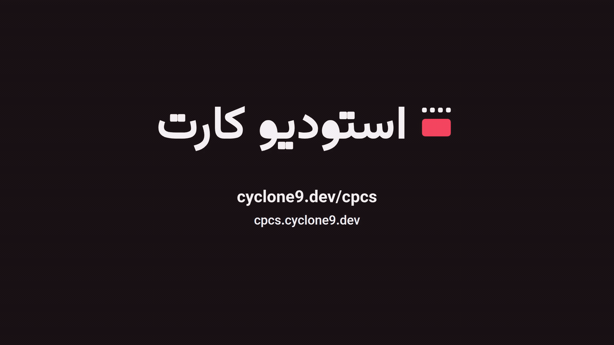

# CPCS - CyClone Power Card Studio

<picture><source media="(prefers-color-scheme: dark)" srcset="assets/logo/cpcs-lockup-fa-on-dark.svg"></picture>

نسخه‌ی 0.6.1. تغییرات را در [CHANGELOG.md](CHANGELOG.md) ببینید.

**شماره‌ی کارت می‌دهید، تصویر کارت می‌گیرید.**

شماره‌ی کارتی که در گفتگو چسبانده می‌شود، ردیفی از رقم‌هاست که به‌راحتی اشتباه خوانده یا اشتباه تایپ می‌شود. CPCS آن را به تصویر یک کارت تبدیل می‌کند. شماره و نام صاحب کارت را وارد کنید، بانک و قالب را انتخاب کنید و تصویر را دانلود کنید تا در اینستاگرام بگذارید، در پیام بفرستید یا هر جایی که مشتری ببیند قرار دهید. CPCS در مرورگر اجرا می‌شود و سروری پشت آن نیست. ابزاری برای طراحی است، نه درگاه پرداخت.

نگاهی ۳۲ ثانیه‌ای به استودیو کارت. <a href="media/cpcs-video-fa.mp4?raw=true">دانلود ویدیو (MP4، ۲ مگابایت)</a>

## امکانات

- بانک را از شش رقم اول شماره‌ی کارت تشخیص می‌دهد.
- درستی شماره‌ی کارت (الگوریتم Luhn) و شماره‌ی شبا (بررسی mod-97) را بررسی می‌کند.
- فقط بانک‌های فعال پشتیبانی می‌شوند. برای کارت یا شبای بانک ادغام‌شده یا منحل‌شده هشدار می‌دهد و تصویری نمی‌سازد.
- شماره‌ی شبا را می‌توان به‌دلخواه روی کارت گذاشت.
- رقم‌های روی کارت فارسی یا انگلیسی‌اند.
- رنگ کارت به‌طور پیش‌فرض رنگ بانک است و قابل تغییر است.
- تصویر را با قالب PNG و اندازه‌ی ۱۰۸۰ × ۶۸۱ یا ۲۱۶۰ × ۱۳۶۲ دانلود می‌کنید. گزینه‌ی «حجم کمتر» فایل را کوچک‌تر می‌کند.

## پیوندها

- صفحه‌ی محصول: https://cyclone9.dev/cpcs
- کد: https://github.com/cyclone9/CPCS
- خود ابزار: https://cpcs.cyclone9.dev/

## حریم خصوصی

شماره‌ی کارت و نام صاحب کارت از مرورگر شما بیرون نمی‌رود و چیزی به سرور فرستاده نمی‌شود، چون سروری در کار نیست. CPCS ابزار طراحی است و درگاه پرداخت نیست.

## مجوز

کد این پروژه با مجوز MIT منتشر می‌شود و استفاده از آن، از جمله استفاده‌ی تجاری، آزاد است. متن کامل مجوز در [LICENSE](LICENSE) است.

نام و لوگوی استودیو کارت (پوشه‌های `assets/logo/` و `assets/favicon/`) جزو این مجوز نیستند و به CyClone تعلق دارند. نام، لوگو و بنرهای کارت‌دان (پوشه‌ی `assets/cpck/`) هم جزو این مجوز نیستند و به CyClone تعلق دارند. لوگوی بانک‌ها هم جزو مجوز نیست و هر لوگو علامت تجاری صاحب آن است.

